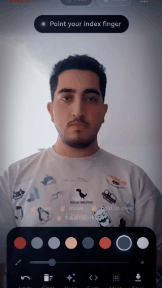
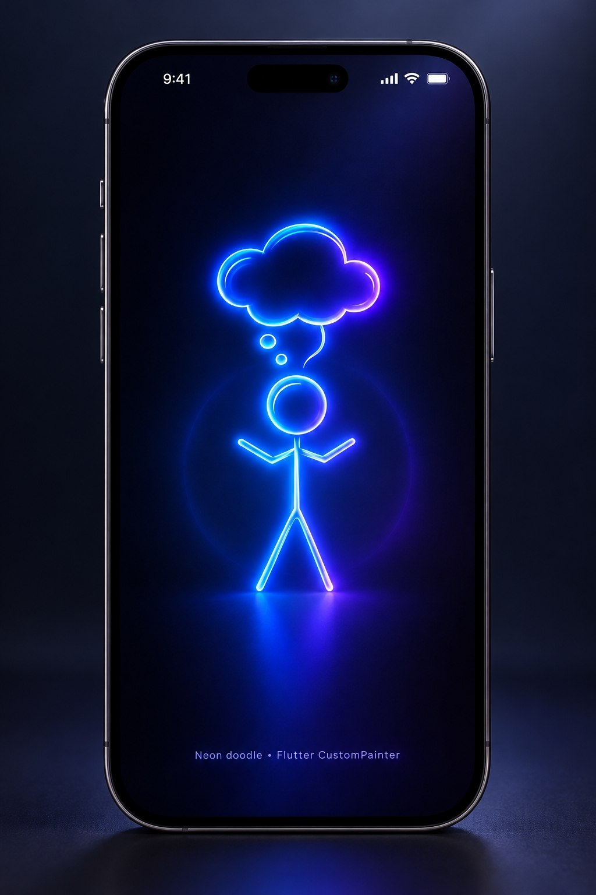
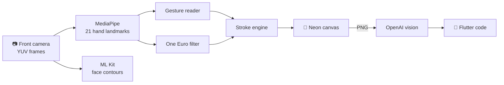

<div align="center">

# ✍️ AirSketch

### Draw in the air. Get real Flutter code.

<table>
  <tr>
    <td align="center"></td>
    <td align="center"></td>
  </tr>
  <tr>
    <td align="center"><sub><b>Drawing with a fingertip</b></sub></td>
    <td align="center"><sub><b>Sketch → Flutter code</b></sub></td>
  </tr>
</table>

<br/>


</div>

---

## 🌌 What is this?

**AirSketch** turns your front camera into a canvas.
It tracks your hand and face in real time, so you can lift one finger and paint glowing neon lines in the air — right on top of yourself.

Then it goes one step further: sketch the layout of an app screen, tap **Code**, and AI writes a complete Flutter screen from your drawing.

> No stylus. No touching the screen. Just your finger and the camera.

## ✨ Features

|  |  |
| :--- | :--- |
| 🖐 **21-point hand tracking** | Real-time landmarks with Google MediaPipe, on the GPU |
| 🙂 **Face mesh** | Live face contours and a HUD frame with ML Kit |
| ☝️ **Gesture control** | Draw, move and clear without touching anything |
| 🪶 **Smooth strokes** | One Euro filter + Bézier curves, so lines look hand-drawn, not shaky |
| 🌈 **Neon brush** | Soft glow with a bright core, or a clean solid line |
| 🪄 **Sketch → Flutter** | A vision model reads your wireframe and returns a runnable `main.dart` |
| 👆 **Touch mode** | Draw with your finger on the screen when you need precision |
| 💾 **Save** | Export your sketch to the gallery in 2x quality |
| 🔒 **Private** | Tracking runs fully on-device; your API key never leaves secure storage |

## 🤌 Gestures

<div align="center">

| Gesture | Action |
| :---: | :--- |
| ☝️ &nbsp; Index finger up | **Draw** |
| ✌️ &nbsp; Index + middle up | **Move** the pen without drawing |
| ✊ &nbsp; Fist | **Pause** |
| 🖐 &nbsp; Open palm, hold 1.5s | **Clear** the canvas |

</div>

> 💡 Keep your hand 40–70 cm from the phone, in a well-lit room, for the best tracking.

## 🪄 Sketch to Flutter

1. Tap ⚙️ and paste your **OpenAI API key**
2. Sketch a screen — in the air or with touch
3. Tap **Code**
4. Copy the generated `main.dart` and run it

**The drawing language**

| You draw | It becomes |
| :---: | :--- |
| ▭ &nbsp; Big rectangle | Card, container or section |
| ▭ &nbsp; Small wide rectangle | Button or text field |
| ◯ &nbsp; Circle | Avatar or icon |
| ─ &nbsp; Short line | Text |
| ☒ &nbsp; Box with an X | Image |
| ✍️ &nbsp; Handwritten word | The real label |

The key is stored with `flutter_secure_storage` on the device only. It is never part of the source code. The model defaults to `gpt-5-mini` and can be changed in settings.

## ⚙️ How it works



- Hand frames go to MediaPipe at ~30 fps on the GPU
- Face detection runs every 250 ms, with the YUV → NV21 conversion in a background isolate
- Finished strokes are baked into a single image, so the glow costs nothing while you keep drawing
- Camera, tracking and drawing layers each live in their own `RepaintBoundary`

## 🧱 Tech Stack

| Part | Package |
| --- | --- |
| State & navigation | [`get`](https://pub.dev/packages/get) |
| Camera | [`camera`](https://pub.dev/packages/camera) |
| Hand landmarks | [`hand_landmarker`](https://pub.dev/packages/hand_landmarker) |
| Face contours | [`google_mlkit_face_detection`](https://pub.dev/packages/google_mlkit_face_detection) |
| Permissions | [`permission_handler`](https://pub.dev/packages/permission_handler) |
| Gallery | [`gal`](https://pub.dev/packages/gal) |
| Networking | [`http`](https://pub.dev/packages/http) |
| Secure storage | [`flutter_secure_storage`](https://pub.dev/packages/flutter_secure_storage) |

## 📂 Project Structure

```
lib/
├── main.dart
├── controllers/
│   ├── code_controller.dart
│   ├── permission_controller.dart
│   ├── settings_controller.dart
│   ├── sketch_controller.dart
│   └── tracking_controller.dart
├── models/
│   └── stroke.dart
├── services/
│   └── openai_service.dart
├── utils/
│   ├── hand_gesture.dart
│   ├── nv21.dart
│   └── one_euro_filter.dart
├── views/
│   ├── code_view.dart
│   ├── permission_view.dart
│   ├── settings_view.dart
│   └── sketch_view.dart
└── widgets/
    ├── code_highlighter.dart
    ├── glass_panel.dart
    ├── sketch_painter.dart
    ├── tool_bar.dart
    ├── top_bar.dart
    └── tracking_painter.dart
```

## 🚀 Getting Started

```bash
git clone https://github.com/hosseinabdollahi84/air_sketch.git
cd air_sketch
flutter pub get
flutter run
```

**Requirements**

- Flutter 3.44+
- JDK 17+
- A real Android phone (API 24+) — emulator cameras are not good enough for hand tracking

**Run the tests**

```bash
flutter test
```

## 🗺 Roadmap

- [ ] iOS hand tracking
- [ ] Live preview of the generated screen
- [ ] "Guess what I'm drawing" game mode
- [ ] Pinch to pick colors in the air
- [ ] Record a video of the drawing

## 🤝 Contributing

Issues and pull requests are welcome. If you have an idea, open an issue first so we can talk about it.

## 📄 License

Released under the [MIT License](LICENSE).

---

<div align="center">

### 🇮🇷 فارسی

**AirSketch** با دوربین جلو دست و صورتت رو تشخیص می‌ده و با نوک انگشت اشاره روی هوا نقاشی می‌کشی.
یه صفحه‌ی اپ رو بکش، دکمه‌ی **Code** رو بزن و کد کامل Flutter اون صفحه رو تحویل بگیر.

☝️ کشیدن &nbsp;·&nbsp; ✌️ جابه‌جا کردن قلم &nbsp;·&nbsp; 🖐 نگه داشتن کف دست برای پاک کردن

<br/>

If you like it, a ⭐ helps a lot!

Made with 💜 by [Hossein Abdollahi](https://github.com/hosseinabdollahi84)

</div>
